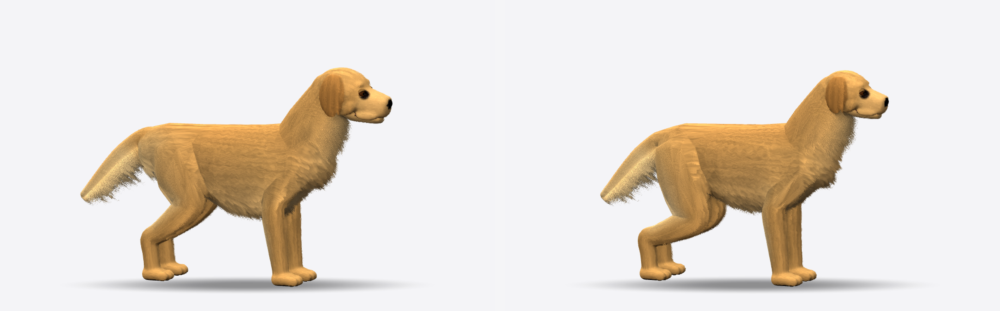
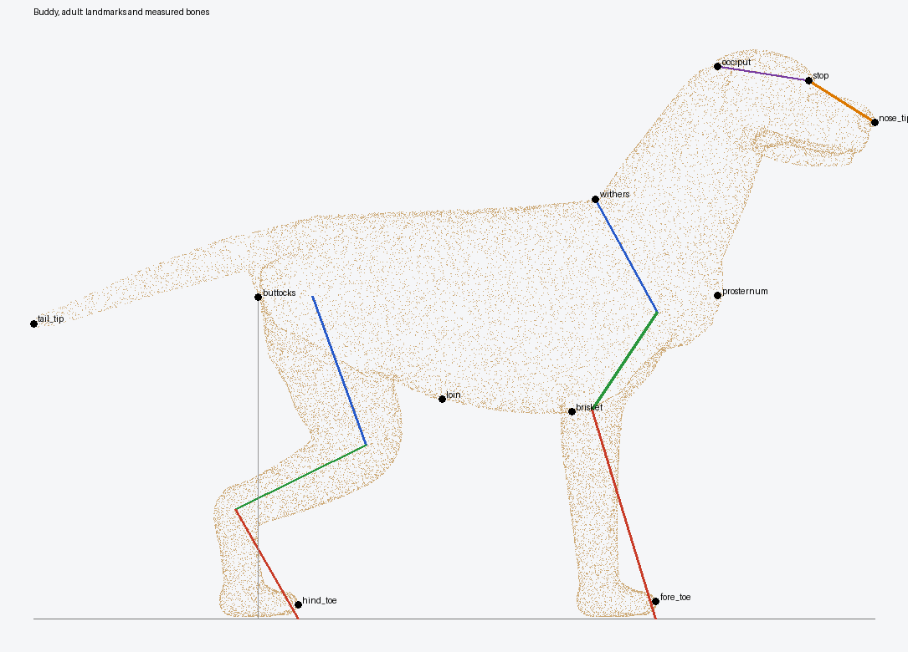
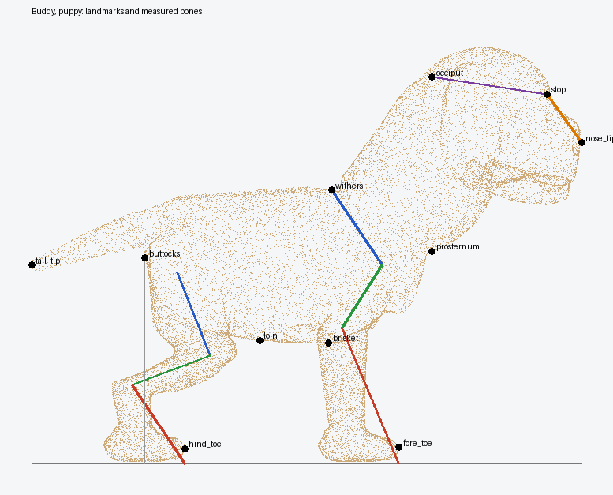

# Buddy's proportions, measured against a real Golden Retriever

Buddy's body is built from numbers (`tools/build_dog.py`). This note compares those
numbers with what is known about the proportions of a Golden Retriever, says where
each reference comes from and how far it can be trusted, and records what was changed
in November 2026 as a result.

Everything here is a **ratio**: mostly a length divided by the height at the withers
(H). The size he is drawn at on the screen, his scale factor and his window were left
exactly as they were; only the proportions inside the body changed. His height at the
withers is 0.715 units before and 0.716 after.

## What kinds of evidence there are, and why they are not mixed

Measurements of dogs come in kinds that do not compare with one another. A breed
standard measures the outside of a live dog in its coat; a skeletal study measures
between bones. Each reference below is only compared with the same kind of
measurement on Buddy: external ones on the surface of his body, skeletal ones between
the joints of his skeleton.

| Kind | What it is | Measured on | How far to trust it |
|---|---|---|---|
| **S** Breed standard | The AKC standard (1990, written by the Golden Retriever Club of America), the FCI standard No. 111, the Canadian and UKC standards | The ideal live dog, coat pressed flat, between landmarks a judge can feel: withers, breastbone (prosternum), point of buttocks (ischial tuberosity), elbow, stop, occiput, hock | Describes an ideal, not the average dog, and gives few numbers. The GRCA notes that many show Goldens today are longer and lower than the standard asks |
| **J** Judges' education | GRCA, *Length of leg in review* (2018) | The same landmarks | Interprets the standard ("leg length about equal to withers to elbow"); not the standard itself |
| **K** Skeletal science | Helmsmüller, Wefstaedt, Nolte & Schilling (2013), *Ontogenetic allometry of the Beagle*, BMC Vet. Res. 9:203. Fischer & Lilje (2011), *Dogs in Motion* (Jena: 327 dogs of 32 breeds, high-speed X-ray). Zink & Schlehr (2020), *Working dog structure*, Front. Vet. Sci. 7:559055 | Beagles: six brothers measured from 9 to 51 weeks of age, and their parents, with a tape between bony landmarks felt through the skin (±5 mm). Fischer & Lilje: X-ray video of moving dogs | The limb shares are Beagles', not Goldens'. Fischer & Lilje found the proportions of the foreleg nearly the same in every breed they measured (the upper arm constant, the shoulder blade 24–34% of the foreleg), which is why they are used; that the hind leg transfers as well is an assumption. Only a press summary of Fischer & Lilje could be read |
| **P** Photographs | Measured for this note on two freely licensed side views of standing adult Goldens: *Agnes the Golden Retriever* (CC BY-SA 4.0) and *Golden Retriever dark stacked* by Sarbajit Sarbajna (CC BY 2.0), on Wikimedia Commons | Landmarks read by eye on a 10-pixel grid | Two dogs only; the coat hides the occiput and the point of buttocks; the second dog's head is turned slightly towards the camera. Take these as ±10%. They are used only where the standards give no number (the length of the head, the neck, the hocks) |

What was looked for and not found in open sources: measured bone lengths or a
cephalic index (skull width to length) for Goldens specifically. So the width of his
head was not assessed.

## How Buddy is measured

`tools/measure_dog.py` reads `renderer/dog/retriever.json` and finds the landmarks
on his surface, sampled evenly (400,000 points), standing at rest:

- **withers**: where the top line of the back, followed forwards, turns up into the
  neck (its slope first exceeds 30°); **H** is its height above the ground
- **prosternum**: the most forward point of the chest between the elbow and just above
  the point of the shoulder
- **point of buttocks**: the hindmost point of the body between 0.55 H and 0.12 H
  below the tail root, and no further back than just behind it (so not the tail)
- **brisket**: the lowest point of the chest along the middle, from the elbow forwards
- **loin underline**: the lowest point along the middle between 25% and 40% of the
  body length from the buttocks
- **toe tips**: the most forward points of the front and the hind feet on the ground
- **occiput, stop, nose tip**: recorded by `tools/build_dog.py` where it builds the head
- **shoulder, elbow, hip, stifle, hock**: the joints of his skeleton. These are joint
  centres, not the bony points a hand feels through the skin, so they sit a little
  inside where a vet would measure; that is a small, systematic difference

## The adult: before and after

| Measure | Reference | Kind | Before | After |
|---|---|---|---|---|
| Body length (prosternum to point of buttocks) / H | 12:11 = 1.09 (1.05–1.13) | S | **1.21** | 1.09 |
| Elbow height / H | about 0.5 | S, J | 0.52 | 0.50 |
| Brisket against the elbow (in H) | level with it | S | **0.056 below** | 0.005 below |
| Depth of chest / H | about 0.5 | S, J | **0.54** | 0.51 |
| Tuck-up (loin underline / brisket height) | "very little" (1.0–1.25) | S | 1.14 | 1.06 |
| Head, occiput to nose tip / H | 0.385 and 0.385 (0.35–0.42) | P | **0.46** | 0.40 |
| Muzzle / skull (stop to nose, occiput to stop) | about 1 (S); 0.74 and 0.82 (P) | S, P | 0.85 | 0.85 |
| Neck, withers to occiput / H | 0.42 and 0.42 | P | 0.45 | 0.43 |
| Hock height / H | 0.27 and 0.24; "well let down" | P, S | 0.26 | 0.26 |
| Upper arm / shoulder blade | "about the same length" (S); 0.88 (K) | S, K | **0.68** | 0.91 |
| Shoulder blade, share of the foreleg | 28.1% (24–34%) | K | 29.2% | 27.8% |
| Upper arm, share of the foreleg | 24.8% | K | **19.7%** | 25.2% |
| Forearm and forefoot, share | 47.1% | K | 51.1% | 47.0% |
| Shoulder blade, angle from vertical | about 30° | K | 22° | 29° |
| Femur, share of the hind leg | 35.9% | K | **29.9%** | 36.8% |
| Shin, share of the hind leg | 33.7% | K | **38.2%** | 33.9% |
| Hind foot, share of the hind leg | 30.4% | K | 31.9% | 29.2% |
| Plumb line from the point of buttocks to the hind toes (in H) | at the front of the toes, or within half a foot | K | **0.25 ahead** | 0.09 ahead |
| Tail reach (tail length / tail root height above the hock) | reaches the hock, not below | S | 0.94 | 0.94 |

In bold, what was outside the references before. In short, the old body was too long,
mostly behind the hips; the chest hung below the elbows; the head was a fifth too
big; the upper arm was short and upright; and the hind leg had a short femur and a
long shin, which stood the hind feet well ahead of the buttocks, where a Golden stands
with them about under the point of buttocks.

## The puppy

There is no breed standard for a puppy. The one quantitative reference is the
Beagle study, which measured the same puppies at nine weeks. Buddy's puppy body is
made from the adult's by a single rule (`as_puppy` in `tools/build_dog.py`). After
the adult was corrected the puppy followed only partly: the shoulder blade, which
lies in the body, kept the adult's length while the leg below it was shortened, and
the shin came out a little long. So the rule now also lifts the puppy's shoulder joint
and, less, his elbow, and his hock, by amounts solved with `tools/measure_dog.py` to
give those puppies' shares. The lift fades out gradually away from the legs and is
nothing at the ground and at the withers.

| Limb share | Beagle puppies, 9 weeks | Before | After the adult was corrected | Now |
|---|---|---|---|---|
| Shoulder blade | 29.0% | 37.6% | 35.2% | 28.9% |
| Upper arm | 24.0% | 17.0% | 21.9% | 24.1% |
| Forearm and forefoot | 47.0% | 45.4% | 42.9% | 47.0% |
| Femur | 33.8% | 30.1% | 33.9% | 33.4% |
| Shin | 30.9% | 34.7% | 33.4% | 31.3% |
| Hind foot | 35.2% | 35.1% | 32.6% | 35.3% |

The shin and hind foot were reported as matching after the adult was corrected; they
did not quite (33.4% against a range of 29 to 33%, and 32.6% against 33 to 37%). That
was wrong, and is fixed by the lift of the hock.

The plumb line from the buttocks is a rule for adult working dogs and is not scored
for the puppy.

## What was changed

All in `tools/build_dog.py`, under "conformation":

- The **foreleg** joints were placed by the rules above: blade laid back 29°, upper arm
  0.91 of it, elbow under the withers at half the height. Each part of the leg as
  first drawn is carried onto the new joints by `along()`, so it keeps its thickness
  and its coat.
- The **hind leg** was re-jointed the same way: femur longer and at about 100° to a
  30° pelvis, shin shorter, hock and foot further back, so the toes come under the
  buttocks.
- The **rump** behind the hips was shortened to 70%, and the tail moved with it,
  keeping its length.
- The **chest** was made 1 to 2 cm shallower (for a dog 58 cm at the withers), so the brisket comes to the elbow.
- The **head** was made 13% smaller (`HEAD_SIZE` 1.12 to 0.97), keeping its shape.

In `renderer/retriever.gd`, a lying dog's folded knee now rests level with the hip;
with the longer femur, the old rule stood it up over his back.

## What did not change

- His height at the withers, his scale factor, and the size of his window (it is set
  by `get_reach()`, which was not touched).
- Every pose still fits in the window: 136 test pictures, one for each activity, both
  of its variants and both facings, puppy and adult.
- The surface of the puppy derived from the adult has 10 of 40,484 triangles turned
  over (before: 1), all small and on the underside of the chest between the forelegs,
  level with the elbows, where the lift of the puppy's foreleg meets the strong
  shortening of his body in height. Removing them would mean reshaping how the puppy's
  body is lowered, which would undo the shares above.

## Limits

- No Golden-specific skeletal data was found in open sources. The limb shares are
  Beagles', and the hind-leg ones are an assumption beyond what Fischer & Lilje showed.
- The photograph measurements cover two dogs and are approximate.
- The landmarks are found by rules on a 3D surface, not felt by a hand. The
  pictures above show where each one landed, so they can be checked.
- The width of the head, the set and length of the ears, and the shape of the feet were
  not measured.

## Reproduce

    python3 tools/measure_dog.py                     # the adult, against the references
    python3 tools/measure_dog.py --age puppy
    python3 tools/measure_dog.py --picture out.png   # where each landmark landed

## Sources

- AKC Golden Retriever standard (1990), as published by the GRCA: https://grca.org/?p=2521
- FCI standard No. 111, Golden Retriever: https://www.fci.be/Nomenclature/Standards/111g08-en.pdf
- Canadian Kennel Club standard: https://ckc.ca/CanadianKennelClub/media/Breed-Standards/Group%201/Retriever-Golden.pdf
- UKC standard: https://www.ukcdogs.com/docs/breeds/golden-retriever.pdf
- GRCA Judges' Education, *Length of leg in review* (2018): https://grca.org/wp-content/uploads/2019/04/LENGTH-OF-LEG-IN-REVIEW.pdf
- Helmsmüller D, Wefstaedt P, Nolte I, Schilling N (2013). Ontogenetic allometry of the Beagle. BMC Veterinary Research 9:203 (open access, PMC4124762)
- Fischer MS, Lilje KE (2011). *Dogs in Motion*. Press summary: https://phys.org/news/2011-05-dogs-motion.html
- Zink C, Schlehr MR (2020). Working dog structure: evaluation and relationship to function. Frontiers in Veterinary Science 7:559055
- Photographs: https://commons.wikimedia.org/wiki/File:Agnes_the_Golden_Retriever.jpg and https://commons.wikimedia.org/wiki/File:Golden_Retriever_dark_stacked.jpg
